# Prom of Doom: playtest readiness (t-015)

*2026-10-30. The verdict: **ready for a first human trial of the opening week***
(New Game through day 8). Days 9–30 can be played, but no agent has checked them
click by click at every width yet (see Known gaps).

The game lives at `https://kindrobots.org/play/comet-city-academy` (Silas only:
it is private, so nothing is published).

## How it was checked

The real page (`pages/play/comet-city-academy.vue` and its three components) ran
in a Vite harness with Nuxt auto-imports stubbed. Playwright played it by
**clicking only, with no store shortcuts**, at **390 × 844, 768 × 1024 and
1440 × 900**:

- **New Game:** title, origin, affinity, identity card, vow, tutorial.
- **Days 1–8:** map, then scene, then night, then debrief. This included the
  night-three split-or-concentrate dilemma, district patrol nights from day 4,
  an injury followed by an infirmary visit, and a full consent-first romance
  (listen, help, invite, then a date on a later day, ending in a relationship).
- **All six console tabs:** each opened at the top, then scrolled to the bottom.
- **Saving:** show the save code, NEW TERM, load the code back from the title,
  and reload the page to restore the autosave.
- **Keyboard:** 80 Tab presses. Focus never stuck, it reached the console tabs,
  and the focus ring stayed visible.

Every step was audited for:
- page errors, Vue warnings, failed requests or HTTP errors
- shell scroll in either direction, and any element running past the viewport
- broken images and clipped text
- buttons that are not the hit target once scrolled into view

**Result after the fixes: zero issues at all three widths.**

## Defects found and fixed (kind_robots#4521)

| # | Defect | Width | Fix |
|---|---|---|---|
| 1 | A stray `>` and an always-empty **AFTER-ACTION REPORT** box in every daytime scene | all | The box only shows when there are reports |
| 2 | The thirty day lights ran off the console header | 390 | They wrap into two rows of 15 and the serial is hidden on phones |
| 3 | Roster posters were forced into a row, squeezing the portrait to about 15 px and the reaction line to three words | 390 | Posters stay portrait cards |
| 4 | The relationship panel stayed open into the next day and hid the map | all | The panel closes when the day's action is spent |
| 5 | Console tabs opened at the previous tab's scroll offset, and the scene kept 42% of a phone screen while reading Hero, Crew and other tabs | 390/768 | Tabs open at the top, and the scene shrinks to a banner on narrow screens |
| 6 | After NEW TERM a save code could not be loaded, because the import box only existed inside a running term | all | Title → **Settings** → *Continue a term from a save code* |

**Regression tests:**
- `utils/scripts/verifyCometPlaytestReadiness.test.ts` runs in CI as part of
  `test:comet-city-academy`. It plays four seeds from New Game through seven
  days, with at least two different masterminds, and checks:
  - every day goes map → scene → night → debrief
  - teams have one to three heroes
  - night three offers its split choice
  - district patrols from day 4
  - a visited landmark rests for a week
  - autosave and save-code round-trips are deep-equal at dusk and at debrief

  It also has one source contract for each fix above.
- The Playwright scripts stayed in the agent scratchpad and are not committed,
  because the repo has no browser test runner in CI.

## Screenshots

| | |
|---|---|
| Title, phone 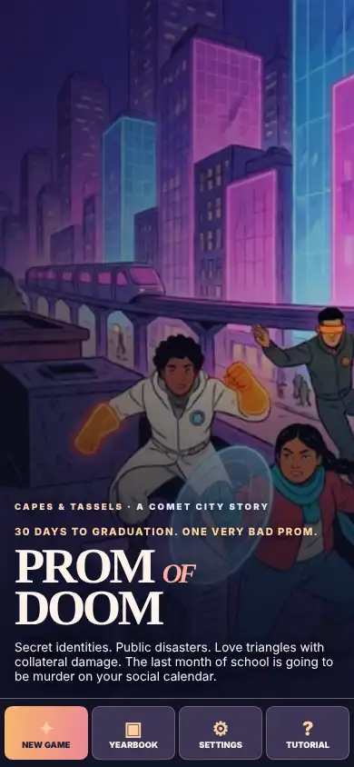 | Identity card, phone 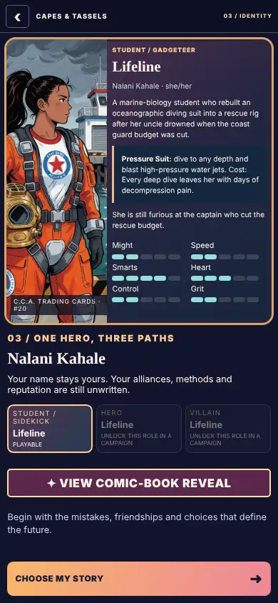 |
| Vow choice, tablet 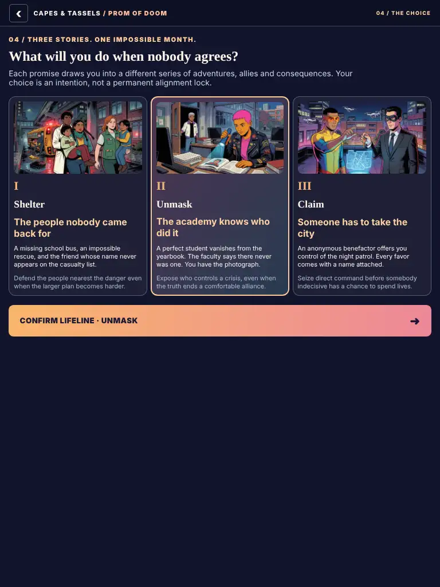 | Day map, desktop 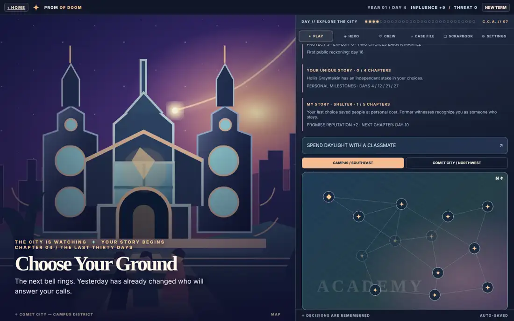 |
| Night three roster (fix 3), phone 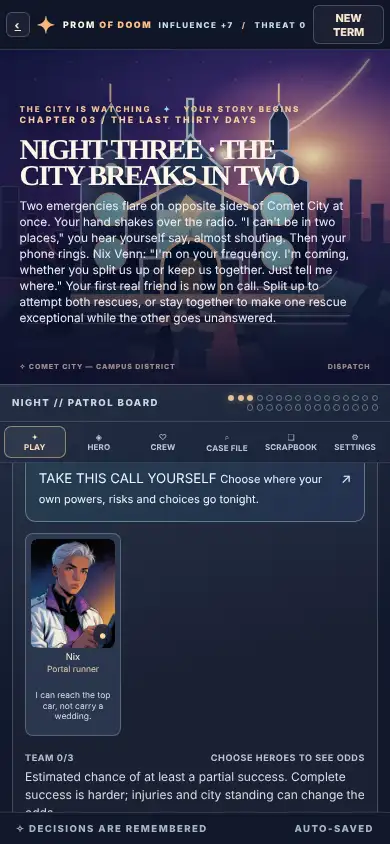 | District patrol night, tablet 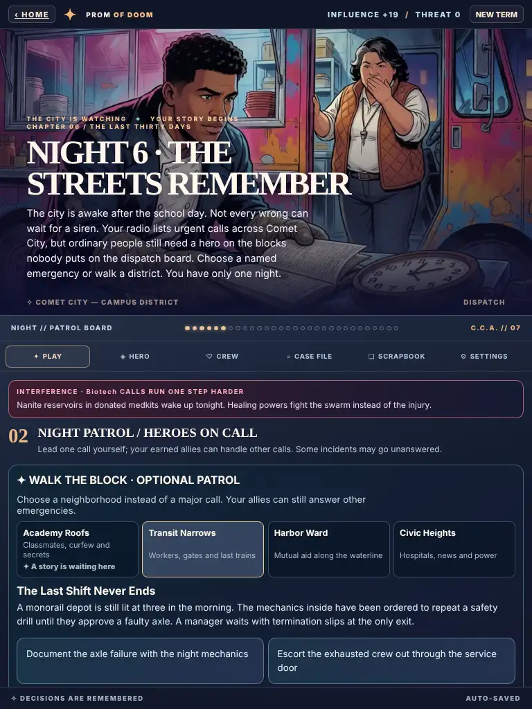 |
| Romance: the date offer, phone 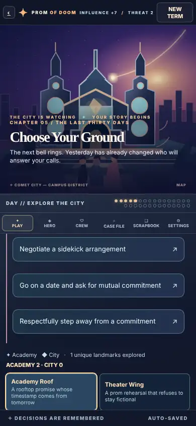 | Infirmary visit, phone 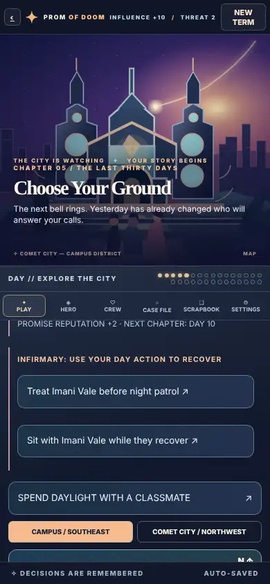 |
| Case File (fix 5), phone 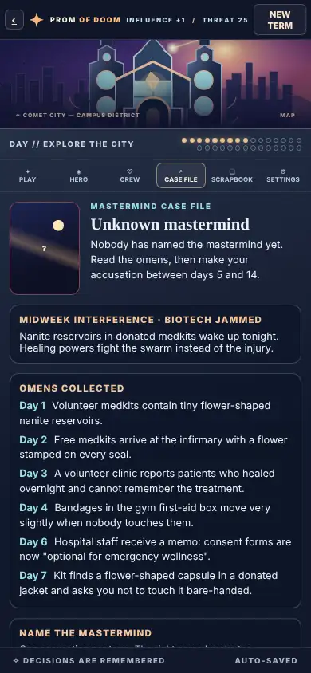 | Scrapbook, tablet 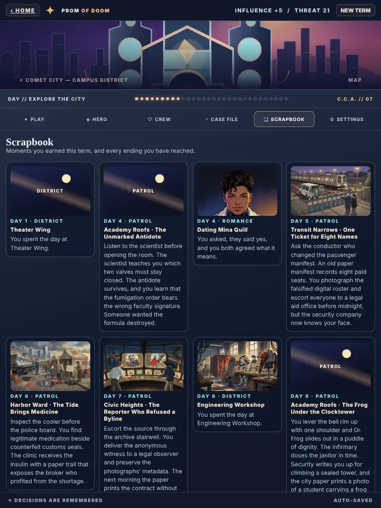 |
| Hero, desktop 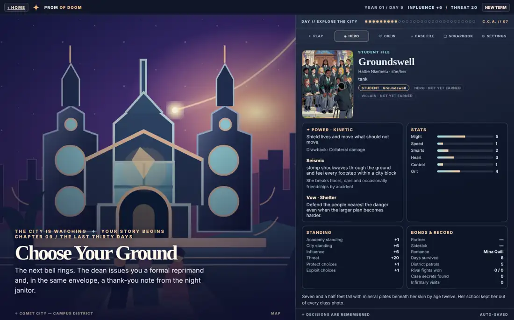 | Load a save from the title (fix 6), phone 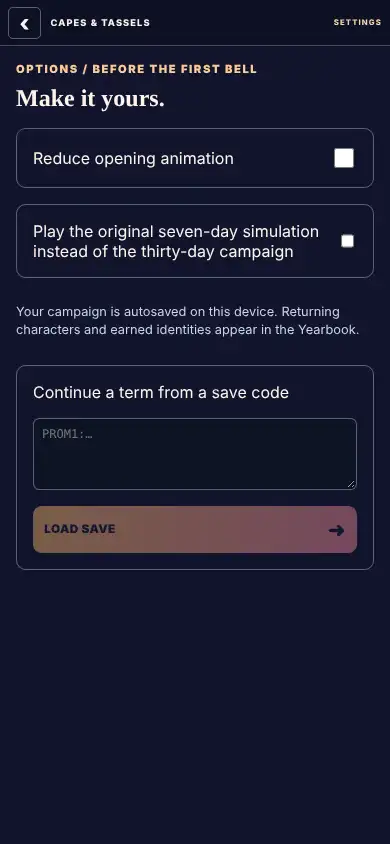 |

## Known gaps (not defects, but a tester will notice)

- **Days 9–30, prom and the endings** are covered by the seeded verifiers
  (patrol stories play twelve seeds through to prom). The click-through at
  every width stopped at day 8.
- **Placeholder art:**
  - The daytime and night stage is usually the drawn academy SVG.
  - Many Scrapbook moments and Crew cards show card backs ("Comet Trail")
    until their renders ship.
  - The mastermind cards on Case File load late on phones.
- **Phone layout:** the scene takes about 42% of the screen during play, so the
  map and the dispatch button sit below a scroll in the console pane. They can
  be reached, but they are not on the first screen.
- **Relationship panel:** while it is open, the landmark list is still visible
  below it. Visiting a landmark from there spends the day normally.
- **Toggles without explanation:** "TAKE THIS CALL YOURSELF" toggles. Tapping it
  a second time un-leads the patrol and greys out *TAKE THE NIGHT PATROL*, with
  no hint about why.
- **Saving:** one autosave slot plus save codes. There are no named save slots,
  no sound and no contrast settings.
- **Tactical fights** (*launch tactical*) were not played in this pass. They
  have their own verifiers (tactical bridge, lieutenants, field loyalty).

## First-time tester script (hand this to a person)

> Thanks for testing **Prom of Doom**, a superhero-school story game. Play on
> your phone if you can. Allow about 25 minutes. There are no wrong answers: we
> want to see where you get confused.
>
> 1. Open the link and tap **NEW GAME**. Pick any origin and affinity you like,
>    read your identity card, and choose one of the three promises.
> 2. Play **one week** (seven days). Each day you:
>    - pick a place on the map
>    - make a choice in its scene
>    - handle the night patrol: lead a call yourself, or from night 4 walk a
>      neighbourhood
>    - read the debrief and tap **ADVANCE TO NEXT DAY**
> 3. On at least two days, tap **SPEND DAYLIGHT WITH A CLASSMATE** and get to
>    know someone. You can ask about dating only after trust is built, and
>    anyone can decline or step away.
> 4. If a friend gets hurt, visit or treat them from the infirmary card.
> 5. Open every tab along the top of the console at least once: **Hero, Crew,
>    Case File, Scrapbook, Settings**. In Case File, see whether you can guess
>    the mastermind from the omens.
> 6. In **Settings**, tap *Show save code* and copy the code somewhere. Then tap
>    **NEW TERM**, confirm, open the title **Settings**, paste the code and tap
>    **LOAD SAVE**. You should be back exactly where you were.
>
> Please write down:
> - the first moment you were unsure what to tap
> - anything that looked broken, cut off, or needed sideways scrolling
> - which classmate or villain you remember, and why
> - whether you would play day 8
> - your device and browser

## Needs Silas

- **Naming collision:** Madame Afterparty's pitched real name **"Imani Calder"**
  collides with two people already in the cast. Student **Imani Vale** shares
  the first name and **Ash Calder** shares the surname. The name is left
  unchanged; it is your call whether to rename her.
- **Approval for human trials:** someone has to approve sending the private link
  to an outside tester and say who that tester is. Agents do not publish or
  invite people.
