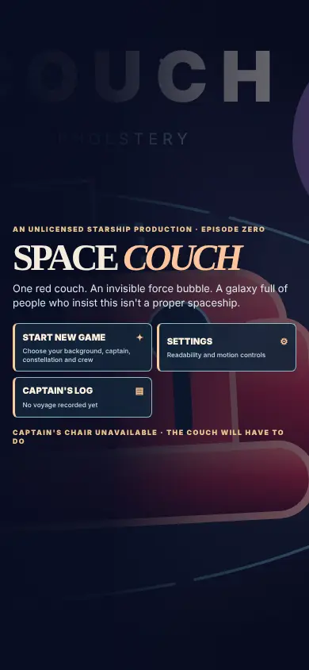
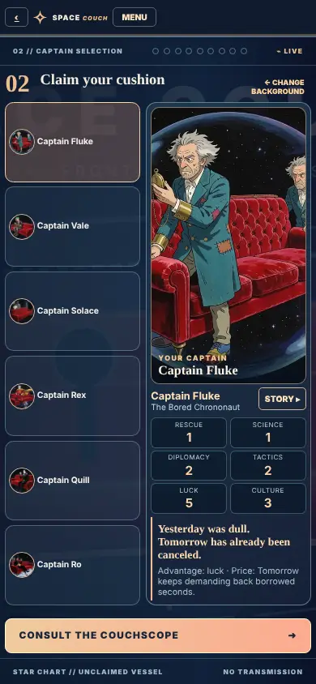
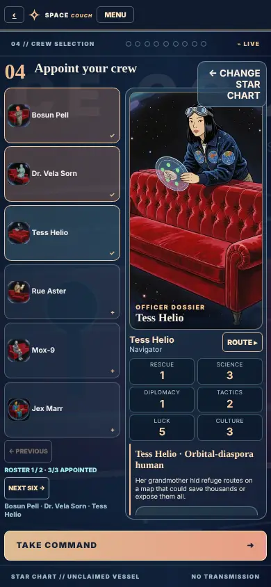
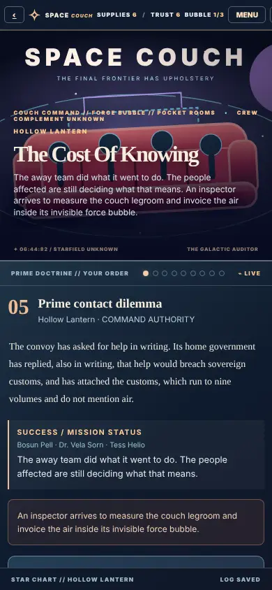
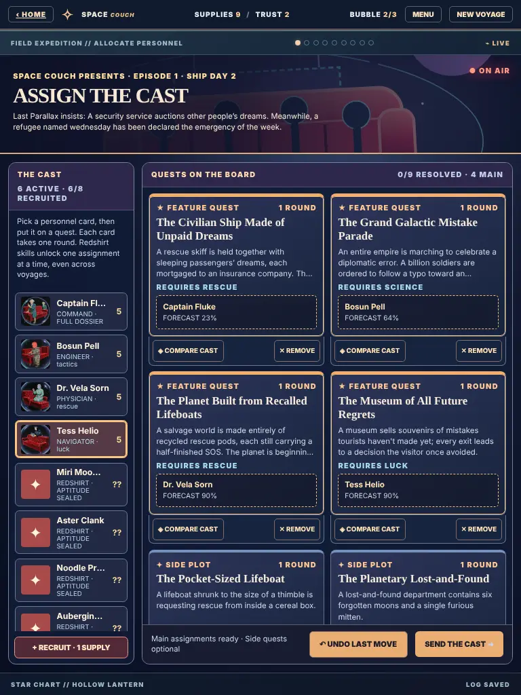
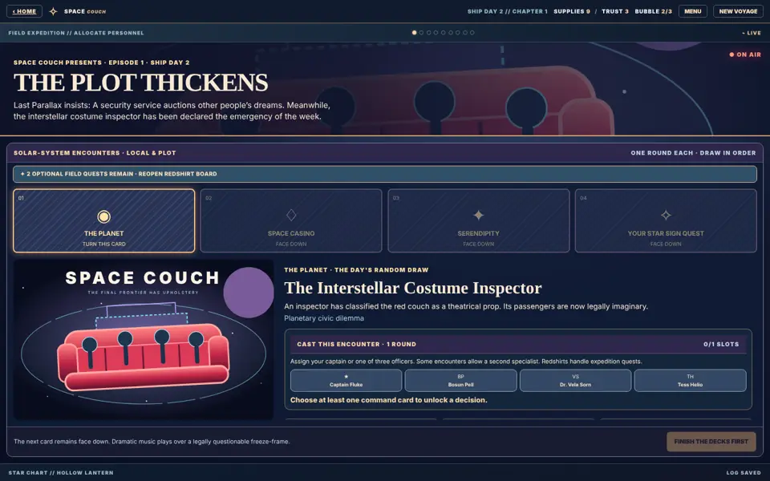
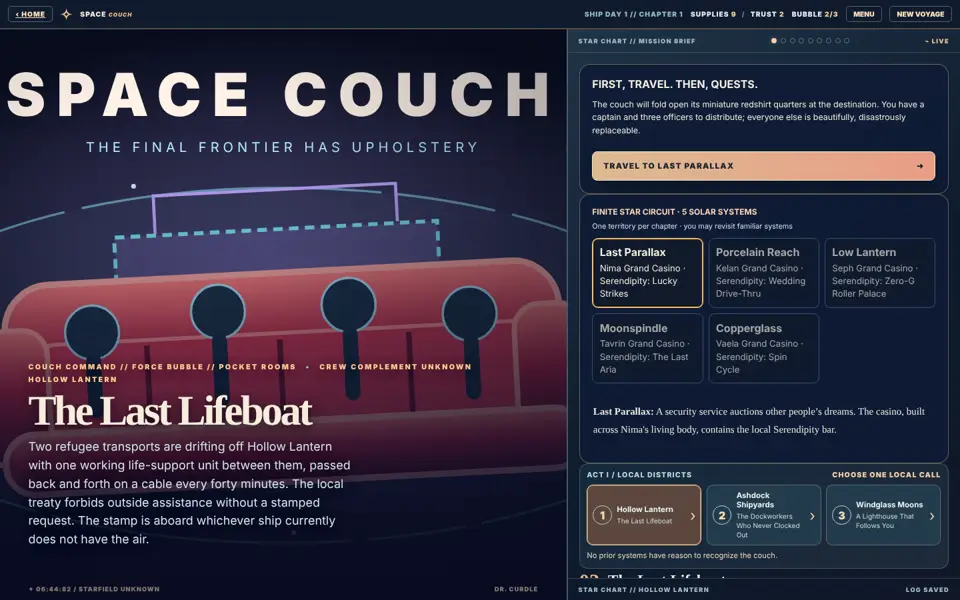
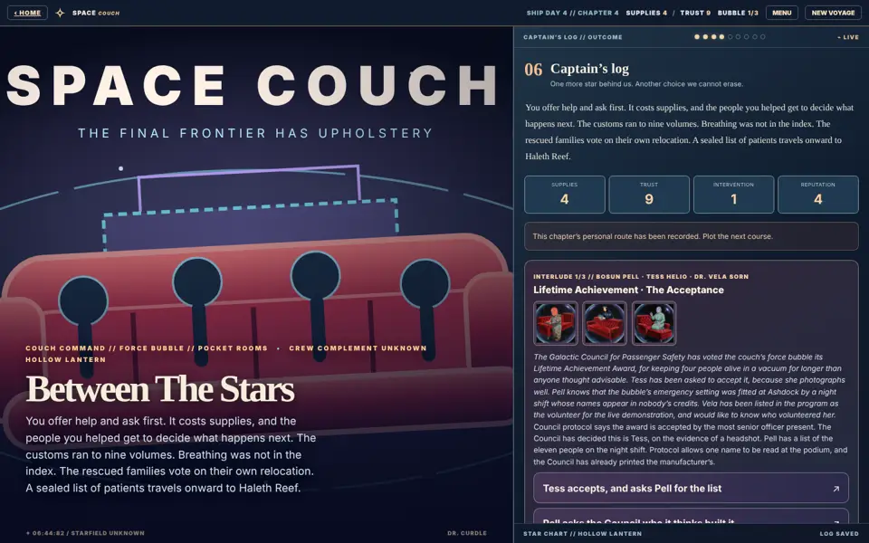
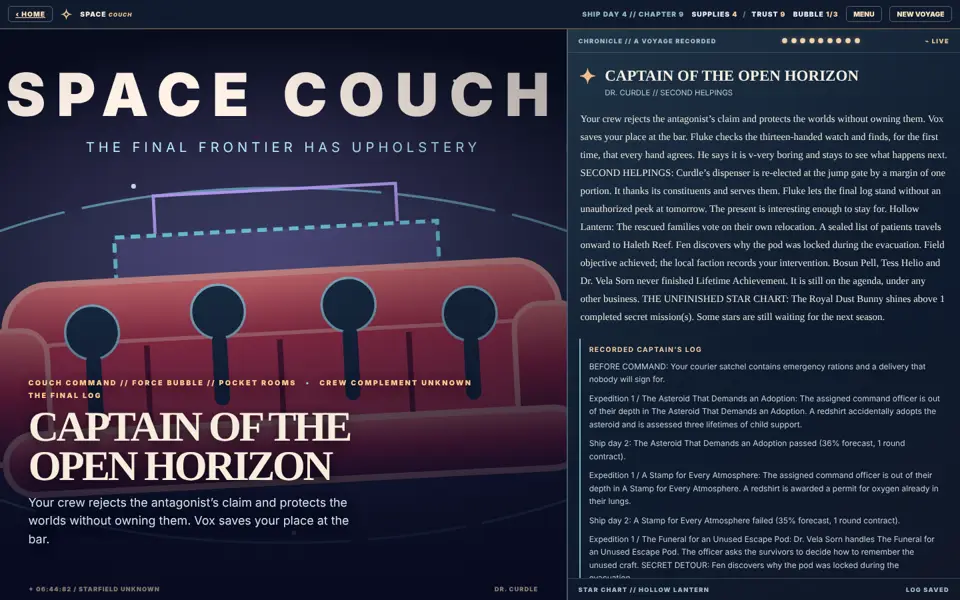
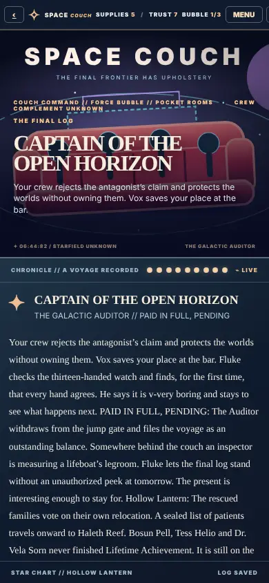

# Space Couch: playtest readiness

Written 2026-10-30 for the first human trials of `/play/game-of-captains`.
The verdict is that **the game can go to testers**. Every screen from the
title to an ending renders and can be clicked at phone, tablet and desktop
widths. Seeded traces cover every antagonist, captain, ending and the counter
council without finding a softlock. Saves made before today's merges still
load and play on to an ending. The art and balance gaps listed below are
known, and testers should be told about them rather than left to rediscover
them.

## What was checked

### Engine traces (t-010)
The traces are in kind_robots #4522:
`utils/scripts/spaceCouchTraceHarness.ts`,
`verifyGameOfCaptainsTraces.test.ts` and
`npm run test:game-of-captains:traces`.

- **Same path as the page.** A deterministic player follows the page's own
  path through the game:
  - background and star chart, then travel;
  - the expedition quest board and the episode decks;
  - the call, transit and order;
  - the debrief, with errands, romance and party interludes;
  - the finale.

  It uses the same store compositions as the page, and nothing is injected
  into the state.
- **Checks on every state.** Each state the player reaches must:
  - save and load unchanged;
  - keep finite stats, with supplies at 0 or above and the shield between
    0 and 3;
  - read without `undefined` or `NaN` leaks;
  - offer at least one control that moves the voyage (the softlock probe).
- **CI subset.** 184 voyages run in about 15s:
  - 8 antagonists × 6 captains, with a counter officer aboard, under six
    adversarial styles: rescuer, noninterventionist, exploiter, legalist,
    misser, and depleted hold with an empty away team;
  - all 16 endings × 6 captains from new voyages;
  - the counter council for every nemesis, and its refusal when no counsel
    is aboard;
  - 12 random-press walks;
  - six real saves written by the engine before today's merges (a34da8fa);
  - bare version-1 saves.
- **Exhaustive run.** `--full` played 2,116 voyages in 234s, including a
  random walk for each of the 220 parties. All passed.
- **Defect fixed.** When a voyage finished all three star quests or the clone
  trial, a coda suffix was added to the ending title
  (`… · The Royal Dust Bunny`). `voyageStageArt` then looked up the ending
  painting by the suffixed title and found nothing. The page does not
  currently use that helper (see the art note below), but the fix is in place
  for when couch renders arrive.

### Rendered UI
The Playwright click-through used the real page component at 390×844,
768×1024 and 1440×900. The fixes are in kind_robots #4524.

It went through title → background → captain → star chart → crew → travel →
quest board → episode decks → staffing and launch → transit → order →
debrief → party interlude → finale → ending. At every screen it audited for:
- page errors;
- blank screens;
- sideways overflow;
- template leaks;
- enabled buttons smaller than 24 px.

Two defects were found and fixed:
1. **The ending stage repeated the whole epilogue over the art.** On desktop
   it also ran the headline into the title lettering. The stage now shows two
   sentences, and the full epilogue stays in the log panel.
2. **Some touch targets were too small.** The star-chart back button, the crew
   page buttons and the quest compare/remove buttons were 13–23 px tall. They
   are now at least 32 px.

After the fixes, the audit reports no problems at any of the three widths.

A red-team catch along the way: the voyage stage shows only the drawn couch
SVG, and that turned out to be correct. The legacy paintings in
`public/game-of-captains/{missions,antagonists,endings}` predate the rename and
show a conventional starship bridge. One ending shows a saucer-hulled starship
uncomfortably close to a famous franchise design. Silas retired bridge imagery
on 2026-10-26. #4524 briefly wired those paintings back in, then reverted
that. It now carries a contract assertion that keeps them off the stage.

## Screenshots

| | |
|---|---|
|  |  |
|  |  |
|  |  |
|  |  |
|  |  |

The trio interlude and the ending in the screenshots were reached from a
seeded save, which explains the chapter jump and the odd trust value.

## Known gaps (tell testers)

- **The voyage has no painted stage art yet.** Every call, nemesis and
  ending appears on the drawn couch SVG. The 10 legacy bridge paintings
  (3 calls, 3 nemeses, 4 endings) are off-identity and should be re-rendered
  with the couch, then removed from the art manifest. There is no
  party-interlude art yet, so the interlude shows the three crew portraits,
  and no Serendipity venue art. All 18 cast portraits (6 captains, 12 crew)
  are in, in their v2 versions, and they carry the dossiers and personnel
  screens.
- **Quest cards repeat.** Acts II and III draw their expedition boards from a
  shared deck of 17 galactic cards (8 major, 9 minor), because their own
  local packs have not been written. Across 30 seeded voyages, about 36 of the
  roughly 59 quest cards a voyage draws are repeats, with the same comic lines
  word for word. Reordering the draw toward unseen cards was measured and
  makes almost no difference, so the real fix is content: local encounter
  packs for Acts II and III. Testers will notice this.
- **Trust swings with the episode decks.** Each deck success adds +1 trust
  and each failure −1. A polite crew can finish around +40 trust, against a
  ±1 effect from the call orders. A MOTION OF NO CONFIDENCE (trust −2 or
  lower) can only be reached by a captain who misses, watches and overrides
  everything. Open Horizon's trust gate is almost always met. This is a design
  decision for Silas; no code changes it yet.
- **Endings and suffixed titles.** The playbook run review receives the
  coda-suffixed ending title, so star-sign finishes are recorded as separate
  endings.
- **Phone layout.** On a 390 px phone the stage banner takes about 40% of the
  height. Action panels (quest board, decks, orders) have to be scrolled to.
  Every control can still be reached.
- **Long logs.** By the jump gate the ending log runs to dozens of lines.
  Readable, but long.
- **Saves are per browser.** Saves live in localStorage, so a tester who
  switches device starts over.

## First-time tester script (20–30 minutes)

1. Open `/play/game-of-captains` in a fresh private window. Read the title
   screen. Can you tell what the game is before you click?
2. **Start new game.** Pick a background, then a captain. Answer the four
   star-chart questions and keep the constellation. Appoint three crew.
   Note any portrait or dossier that confused you.
3. **Travel**, then **arrive**. On the quest board, put a captain or officer
   on each *feature quest* and press *Send the cast*. Optionally, put a
   redshirt on a side plot. Did you understand that redshirts can die?
4. Turn each episode deck in order. For each one, choose one cast member and
   one of ask, document or override. Then *finish the expedition*.
5. Staff the call, deploy a pocket room if you like, and **launch**. Advance
   the ship days until the crew returns. Choose an order: aid, observe or
   intervene. Does the result text match what you expected?
6. In the debrief, try one crew errand. In chapter 1, try the optional
   off-duty conversation, where everyone may say no. From chapter 4, play the
   party interlude.
7. Play on to the jump gate (9 chapters) and choose a final order. Read the
   ending.
8. Reload the tab mid-voyage and press *Continue*. Did you land where you
   left off?
9. Report:
   - where you were confused or bored;
   - any joke that landed or fell flat;
   - anything that read as preachy or cruel;
   - any control you could not reach;
   - your device and browser.

## Red-team first pass (input for t-011)

These notes come from reading seeded transcripts (the exploiter and rescuer
styles) and the rendered screens. They are not the full independent t-011
review.

- **Visual identity.** See the legacy bridge paintings above. Until couch
  renders exist, the drawn SVG couch and the v2 portraits are the identity.
- **Humour wear.** Repeated quest cards replay identical jokes, sometimes in
  consecutive chapters. Examples: "The Hotel at the Heat Death of Time" in
  chapters 4 and 5, and "Personnel prints a tasteful memorial…" after every
  fallen redshirt.
- **Casualty prose.** A fallen redshirt's line reuses the encounter's survival
  gag ("does not return … A redshirt signs a treaty on behalf of a galaxy").
  It reads as darkly funny but slightly incoherent. Dedicated casualty lines
  per encounter would land harder.
- **Consequences.** Call orders move trust by ±1, while the episode decks move
  it by about ±5 per chapter (see the trust note above). That flattens the
  intervention ethics the game is about.
- **Consent and agency.** These hold up:
  - the off-duty scenes say "everyone may say no";
  - pressing a crew member is refused on the record;
  - crew errands cost the crew, not just the captain;
  - the counter council hands the final vote to the people affected.

  No issues found in the samples read.

## Still open

- **t-011:** the full independent red-team of humour, ethics and the couch and
  force-bubble visuals, starting from the notes above.
- **t-012:** the human design acceptance gate. Silas only.
