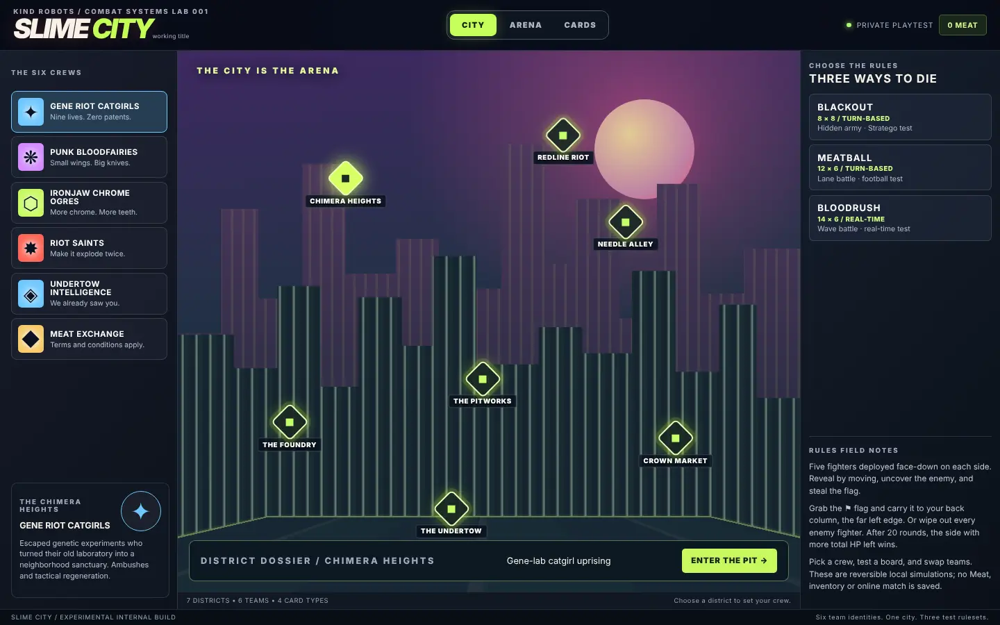
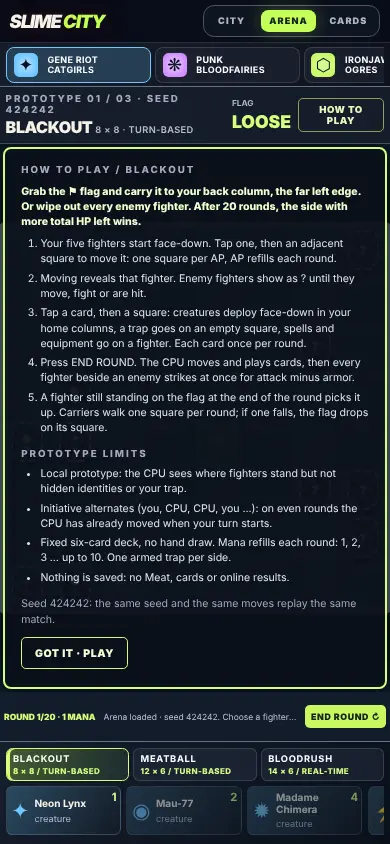
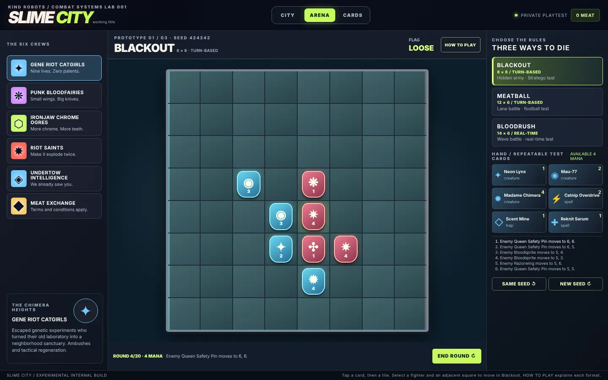
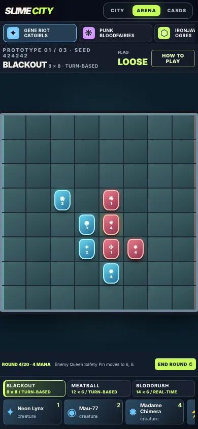
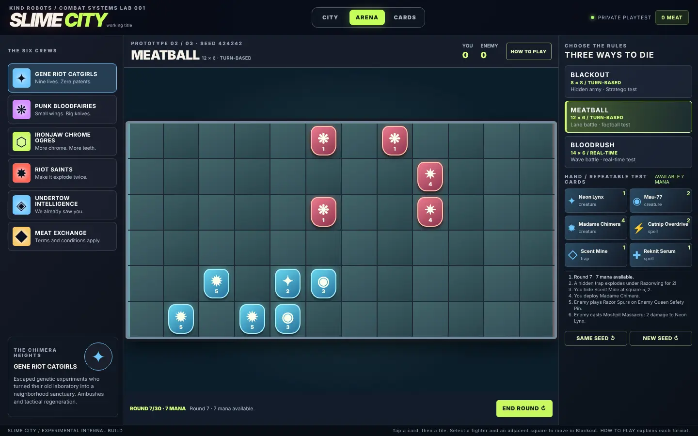
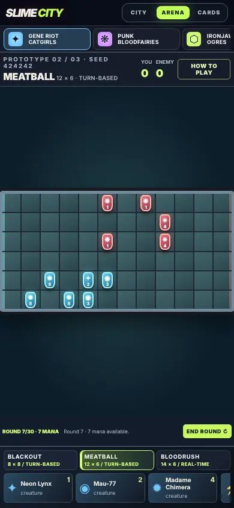
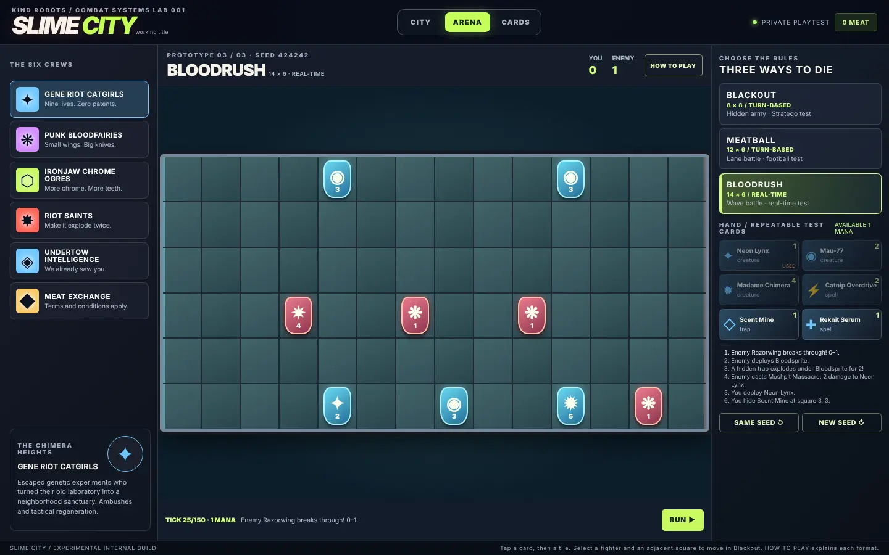
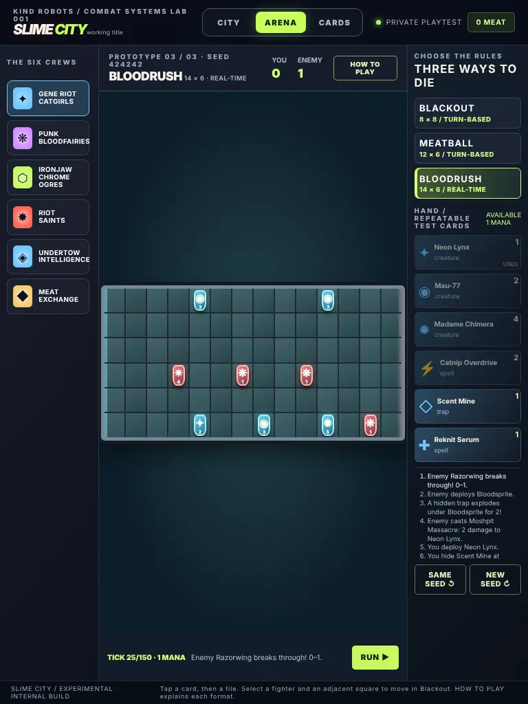
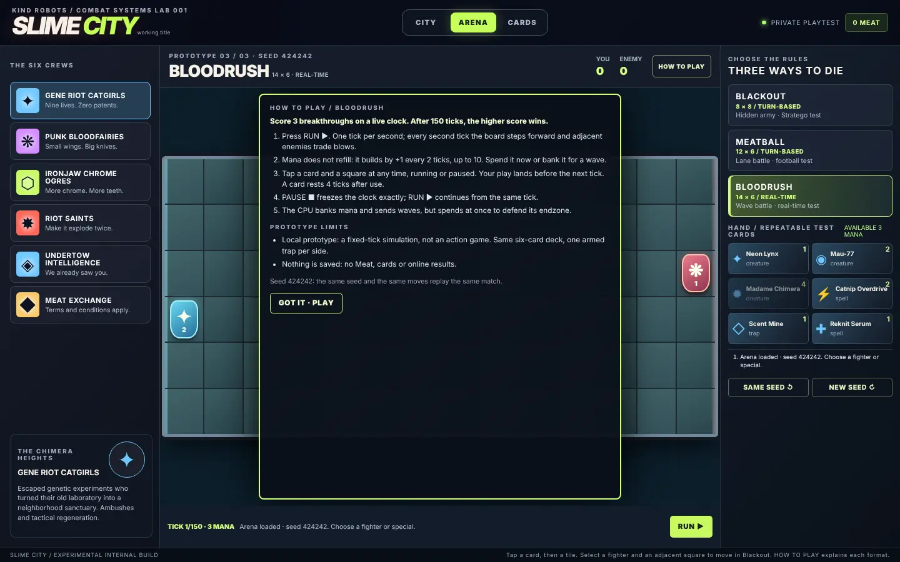

# Slime City: three-format playtest comparison (t-016)

**Status:** evidence for Silas's format decision (t-013), **not** a decision. No mode was chosen, removed or hard-coded. All three stay playable at `/admin/slime-city`.
**Date:** 2026-10-30. **Code:** Kind Robots PR #4496, merged as `f5269545` (t-002 hardening). It adds the CPU, the rules below and the headless harness.

## How this was tested

- **Headless adversarial simulation.** The same CPU plays both sides, each from its own redacted view (it never sees hidden identities or the other side's trap). Every ordered pairing of the six crews (30 pairings) × 20 seeds = **600 matches per format, 1,800 in total**. Every match replays exactly from its command record, and the contract test checks that.
  - Reproduce: `npx tsx utils/scripts/slimeCityPlaytest.ts 20` in Kind Robots (about 15 s). Add `--json` for raw per-match rows.
- **"First-initiative side"** is the side the human plays (left, `player`). In BLACKOUT and MEATBALL, initiative then alternates (player, CPU, CPU, player…). In BLOODRUSH both sides act every tick: the human between ticks, the CPU on the tick.
- **Manual pass.** The real page component (`pages/admin/slime-city.vue` with its Pinia store) was rendered in Chromium at 390×844, 768×1024 and 1440×900. Each format was opened, its HOW TO PLAY panel read, and a mid-match board captured. Results are under *Screenshots*.
- **What this is not.** These are CPU-vs-CPU numbers. They say whether a format *stalls, snowballs or favours a crew* under competent, symmetric play. They cannot say what is fun. That remains Silas's call, and human playtests are still needed (rubric questions 1, 2, 6 and 7 are mostly human questions).

## Rules under test (as merged in #4496)

| | BLACKOUT 8×8 | MEATBALL 12×6 | BLOODRUSH 14×6 |
| --- | --- | --- | --- |
| Cadence | Turns; initiative alternates | Turns; initiative alternates | 1 s fixed ticks; board steps and fights every 2nd tick |
| Start | 5 face-down fighters each, seeded placement in two home columns | One runner each, seeded lane | Same as MEATBALL |
| Mana | Refills to round number (cap 10) | Same | Banks +1 per 2 ticks from 3 (cap 10) |
| Cards | Each card once per round, one armed trap, max 7 fighters | Each card once per round, one armed trap, max 6 fighters | Card rests 4 ticks, one armed trap, max 6 fighters |
| Movement | Manual, 1 square per AP | Auto 1 square (3+ AP sprints 2); sidestep or juke around blockers | Same as MEATBALL, on the beat |
| Win | Flag carried to your back column; rout; after 20 rounds, more total HP | 3 breakthroughs; after 30 rounds, higher score | 3 breakthroughs; after 150 ticks, higher score |
| Flag | Picked up at end of round (after blows); carrier 1 AP; drops where its carrier falls | – | – |

Combat in all three: every fighter beside an enemy strikes one of them simultaneously for `max(0, attack − armor)`, preferring a flag carrier, then a kill, then the weakest. Mutual knockouts are legal.

## Headline comparison (600 matches each)

| Metric | BLACKOUT | MEATBALL | BLOODRUSH |
| --- | --- | --- | --- |
| Mean length (rounds/ticks) | 12.4 | 25.0 | 68.8 ticks ≈ 69 s |
| Median / p90 length | 12 / 20 | 27 / 30 | 44 / 150 |
| Decided by round/tick 4 | 14.3% | 0.0% | 0.0% |
| Hit the round/tick limit | 30.5% | **44.5%** | 15.3% |
| Draws | 0.8% | **27.2%** | 8.2% |
| First-initiative side wins | 53.2% | 35.7% | 39.8% |
| Second side wins | 46.0% | 37.2% | 52.0% |
| Decided by flag | 69.3% | – | – |
| Decided by breakthroughs | – | 54.2% | 82.0% |
| Decided by rout | 0.2% | – | – |
| Decided on the clock (not a draw) | 29.7% | 18.7% | 9.8% |
| First contact (mean round/tick) | 1.5 | 3.7 | 7.7 |
| Rounds where nothing changed | 0.0% | 0.0% | 47.7%* |
| Comeback wins (winner trailed clearly after round 2) | **47.7%** | 7.7% | 6.7% |
| Lead changes per match | 2.37 | 5.60 | 2.00 |
| Lane clogs per match (blocked, no free lane) | 0.00 | 1.43 | 0.04 |
| Sidesteps per match | 0.0 | 15.6 | 10.1 |
| Knockouts per match | 32.3 | 35.2 | 21.8 |
| Flag drops per match | 3.14 | – | – |
| Creature / spell / trap / equipment plays per side | 17.1 / 7.9 / 1.3 / 4.0 | 22.9 / 20.3 / 10.5 / 13.0 | 15.0 / 5.1 / 3.7 / 0.4 |
| Traps sprung per match | 1.9 | 20.1 | 6.8 |

\*BLOODRUSH's "nothing changed" figure is mostly structural: by rule, the board only steps on every second tick. Those ticks are breathing room for between-tick plays, not stalls. Only 13.3% of BLOODRUSH matches had three or more dead ticks in a row.

### Crew win share (wins + half of draws, both sides)

| Crew | BLACKOUT | MEATBALL | BLOODRUSH |
| --- | --- | --- | --- |
| Gene Riot Catgirls | 49.0% | **24.3%** | 62.8% |
| Punk Bloodfairies | 33.3% | 62.5% | 33.8% |
| Ironjaw Chrome Ogres | 44.0% | 36.0% | 56.5% |
| Riot Saints | 37.5% | 51.5% | 36.8% |
| Undertow Intelligence | 64.3% | 51.0% | 28.8% |
| Meat Exchange | **72.0%** | **74.8%** | **81.5%** |

### Head-to-head (row crew's win share against column crew, both sides, 40 matches per cell)

BLACKOUT

| vs | catgirls | bloodfairies | ironjaw | riot | undertow | exchange |
| --- | --- | --- | --- | --- | --- | --- |
| catgirls | – | 52.5% | 65.0% | 65.0% | 27.5% | 35.0% |
| bloodfairies | 47.5% | – | 62.5% | 30.0% | 8.8% | 17.5% |
| ironjaw | 35.0% | 37.5% | – | 47.5% | 37.5% | 62.5% |
| riot | 35.0% | 70.0% | 52.5% | – | 17.5% | 12.5% |
| undertow | 72.5% | 91.3% | 62.5% | 82.5% | – | 12.5% |
| exchange | 65.0% | 82.5% | 37.5% | 87.5% | 87.5% | – |

MEATBALL

| vs | catgirls | bloodfairies | ironjaw | riot | undertow | exchange |
| --- | --- | --- | --- | --- | --- | --- |
| catgirls | – | 10.0% | 70.0% | 17.5% | 15.0% | 8.8% |
| bloodfairies | 90.0% | – | 57.5% | 63.8% | 72.5% | 28.8% |
| ironjaw | 30.0% | 42.5% | – | 47.5% | 32.5% | 27.5% |
| riot | 82.5% | 36.3% | 52.5% | – | 48.8% | 37.5% |
| undertow | 85.0% | 27.5% | 67.5% | 51.3% | – | 23.8% |
| exchange | 91.3% | 71.3% | 72.5% | 62.5% | 76.3% | – |

BLOODRUSH

| vs | catgirls | bloodfairies | ironjaw | riot | undertow | exchange |
| --- | --- | --- | --- | --- | --- | --- |
| catgirls | – | 90.0% | 32.5% | 80.0% | 93.8% | 17.5% |
| bloodfairies | 10.0% | – | 51.3% | 55.0% | 50.0% | 2.5% |
| ironjaw | 67.5% | 48.8% | – | 66.3% | 60.0% | 40.0% |
| riot | 20.0% | 45.0% | 33.8% | – | 72.5% | 12.5% |
| undertow | 6.3% | 50.0% | 40.0% | 27.5% | – | 20.0% |
| exchange | 82.5% | 97.5% | 60.0% | 87.5% | 80.0% | – |

## What the numbers say, format by format

### BLACKOUT (hidden army, 8×8): the most tension, the fairest seat, the fastest snowball risk
- **Tension.** It has the most comebacks: 47.7% of winners trailed clearly after round 2. Flag drops average 3.1 per match, so the flag really changes hands. It is also the most decisive format: 0.8% draws.
- **First contact is immediate** (round 1.5), and the first choice (which face-down fighter to commit) has a visible consequence on the same round.
- **Seat fairness.** The first-initiative edge is small (53/46). It took two rule fixes to get there; see *Rule sensitivity*. With the human always moving first and the flag picked up instantly, the first side won 71.5%.
- **Snowball risk.** 14.3% of matches end by round 4. This is a quick flag run where the other side never contested the centre. A human who turtles at home will see this. Counterplay exists (zap or swarm the carrier, which walks 1 AP), but the HOW TO PLAY panel should be watched in real tests.
- **Time limit.** 30% of matches go the full 20 rounds and are decided on HP. This works as a tiebreak but is not exciting.
- **Card feel.** Cards matter, but equipment and traps are the least used here (1.3 traps per side). Movement is the main decision, so it plays more like a tactics game than a card battle (rubric question 6).
- **Crews.** BLACKOUT has the tightest crew spread of the three (33–72%). Punk Bloodfairies are fragile under fog (33%), and Meat Exchange's cheap 3-HP Debt Collectors over-perform.

### MEATBALL (turn lanes, 12×6): the most interaction, but the most draws
- **Interaction.** It has the most lead changes (5.6 per match), the most card plays and every card type in heavy use (about 13 equipment and 10 traps per side). It **feels most like a collectible card battle**.
- **Stalls.** It is also the stall-prone format: **27% draws and 44.5% of matches reach round 30**. Midfield attrition (35 knockouts and 20 trap hits per match) kills runners before they cross 11 squares. Defense is stronger than offense.
- **Pile-ups are fixed.** Only 1.4 clogs per match are left, against 15.6 successful sidesteps. The first prototype (queues, no caps) produced 100% 0–0 draws with gridlocked boards.
- **Comebacks are rare** (7.7%).
- **Crews.** This format is the most crew-polarised. Catgirls 24% and Meat Exchange 75%; Bloodfairies beat Catgirls 90–10.

### BLOODRUSH (live lanes, 14×6): the cleanest finishes, the steepest crew gaps
- **Clean finishes.** 82% of matches end by breakthroughs and only 8% are draws. The median match is about **44 seconds**, and 15% run the full 2.5 minutes.
- **Clock pressure.** The real-time burden is moderate. There is one board step every 2 s, and a play can land while the clock runs or is paused (both are tested). On a phone, the hand is a horizontally scrolling strip; selecting a card and then a square while the clock runs is reachable, but it was not timed with a human.
- **Side edge.** The second side wins 52/40. In the headless harness the CPU acts *on* the tick and sees the opponent's latest plays, which gives it a reactive edge. A human also reacts between ticks, so this edge probably shrinks in person, but it should be watched.
- **Card use is narrow.** Equipment is nearly unused (0.4 per side), because the wave-banking CPU spends on creatures and urgent removal.
- **Crews.** BLOODRUSH has the worst crew spread. Meat Exchange wins 81.5%, beating Bloodfairies 97.5–2.5. Armor and hit points beat swarms whenever blows outpace movement.

## Rule sensitivity (what the tuning runs showed)
These were measured while hardening t-002, using the same harness; "6 seeds" means 180 matches per format. They show which knobs matter and which choices are open for Silas.

| Change | Result |
| --- | --- |
| Lanes as first shipped: queues, no unit cap, repeatable cards, free CPU spawns | MEATBALL 100% draws at 0–0, 374 clogs in one sample match |
| + field cap 6 and stop only when blocked head-on | MEATBALL 80% draws; one crew played its 1-mana heal six times a round |
| + each card once per round, juke around blockers, alternating initiative | MEATBALL 41% draws (6 seeds) |
| + one armed trap per side (was two) | MEATBALL 26% draws; traps sprung fell from 27 to about 20 per match |
| Lane speed = min(AP, 3) instead of "3+ AP sprints 2" | MEATBALL draws 16%, but Bloodfairies 92%, Ironjaw 13%, and in BLOODRUSH Catgirls 100%. Rejected: speed then decides everything. Speed = min(AP, 2) still gave Catgirls 81% |
| BLOODRUSH blows every tick vs every 2nd tick | Ironjaw 84% → 62% (6 seeds). Blows on the beat were kept |
| BLACKOUT, human always first + instant pickup + two-column home | First side 71.5% (600 matches). Some flag runs won in round 2, before the other side's second turn |
| + alternating initiative | First side 58.5% |
| + pickup at end of round + back-column return | First side 53.2% (final) |

## Rubric answers (provisional, CPU evidence only)
1. **Is the first meaningful choice quick and visible?** BLACKOUT: yes, round 1. MEATBALL: first contact around round 4. BLOODRUSH: about 8 ticks (16 s) of build-up.
2. **Are threats legible without a rules essay?** Each format now opens with a 5-step HOW TO PLAY panel plus prototype limits, and the board draws only what the player may know. Human clarity is still **untested**.
3. **Is there counterplay to concealment, swarm, armor and cost?** Concealment: yes; hidden fighters fight back and the CPU must guess. Armor: too strong in BLOODRUSH and against low-attack swarms. 0-damage matchups exist (attack 1 against armor 1+).
4. **Are comebacks earned?** Clearly in BLACKOUT, rarely in the lane formats.
5. **Clogs and stalls?** Pile-ups are fixed. MEATBALL still stalls into draws. BLOODRUSH rarely does.
6. **Does it feel like a card battle?** MEATBALL most, BLACKOUT least.
7. **Turn-based, timed or hybrid, and at which size?** Not decided by agents. The data suggests BLACKOUT's tension and MEATBALL's card density are complementary. A hybrid is a reasonable thing to test only *after* Silas plays all three.

## Screenshots
These are rendered by Chromium from the **real** `/admin/slime-city` page component, store and engine, mounted in a minimal Vite harness. They show none of the Kind Robots site chrome, login or database: `nuxi dev` needs the production database and the route is admin-gated, so the deployed site was **not** captured. Mid-match boards were produced by letting the CPU play the human side for a few rounds; the board still shows only the player's redacted view (enemy `?` tiles are hidden identities). The page was checked at all three sizes with no horizontal overflow and no script errors (the only console error was the harness's missing favicon).

| | |
| --- | --- |
| City map, desktop  | BLACKOUT HOW TO PLAY, phone  |
| BLACKOUT round 4, desktop  | BLACKOUT, phone  |
| MEATBALL round 7, desktop  | MEATBALL, phone  |
| BLOODRUSH tick 25, desktop  | BLOODRUSH, tablet  |
| BLOODRUSH HOW TO PLAY, desktop  | |

All crew art is still the interim CSS and glyph stand-in; no generated art is shown or claimed (t-017).

## Known limits of this evidence
- One CPU persona, playing both sides. A human will exploit things the CPU does not, such as baiting traps, turtling, or ignoring the flag for a rout.
- Crew balance mixes card data with format rules. The Meat Exchange dominance mostly comes from its 1-mana 3-HP Debt Collector and armor-1 brokers; rebalancing belongs to t-004, not here.
- No human-timed input test of BLOODRUSH on a phone.

## Suggested next steps (for Silas to choose; none are started)
- **Silas:** play each format for one match at `/admin/slime-city` after the next rollout and answer t-013 (preferred cadence and board, or a hybrid).
- **Agents, reversible:** t-004 crew data pass (Meat Exchange down, Bloodfairies' fragility, 0-damage armor matchups); t-003 objective toggles (for example a MEATBALL score-or-yardage tiebreak, or BLACKOUT without the round-20 HP decision); t-005 additional CPU personas (turtle, rusher) for a second comparison pass.

## After rebalance: 2026-10-30 (t-004 crews, t-003 objective variants)

**Code:** Kind Robots PR #4520 (`claude/slime-city-crews-22947`). Same harness, same seeds: `npx tsx utils/scripts/slimeCityPlaytest.ts 20` (default rules) and `npx tsx utils/scripts/slimeCityPlaytest.ts 10 --variants`. Everything below is CPU against CPU, as before. No final rule was chosen; that is still Silas's call in t-013.

### What changed (t-004)
- **Six legal ten-card decks.** Each deck has 4 creatures and 6 specials: at least one spell, trap and equipment, and exactly one signature card. That is 60 authored cards in total.
- **Crew identity and counterplay.** Each crew has its own keywords, play pattern and named counter, all shown in THE ARMORY:

| Crew | Play pattern | Signature | Counterplay |
| --- | --- | --- | --- |
| Gene Riot Catgirls | AMBUSH (first blow +2), REGEN while out of reach, Catnip Overdrive re-arms the ambush, Laser Pointer roots | Madame Chimera | Splash and explosions, snares, debt |
| Punk Bloodfairies | SWARM (+1 attack beside a friend), LEECH, Moshpit Massacre (splash that only hits enemies) | Queen Safety Pin | Armor, explosions, isolating a lone fairy |
| Ironjaw Chrome Ogres | Armor, BULLDOZE (in the lanes, shoves a blocker back), plating, Wrecking Fist | Maw-9000 | PIERCE, debt, snares |
| Riot Saints | VOLATILE (explodes on death and chains through friend and foe), Confetti Cannon (splash that hits everyone) | Grand Detonator | Spacing, armor, healing |
| Undertow Intelligence | Two armed traps, SNARE, PIERCE, Drain Sonar (reveals enemies and disarms traps) | Drowned Oracle | Bodies: swarms and regeneration walk through traps |
| Meat Exchange | COLLECT: each damaging blow puts the opponent 1 mana in debt (at most 2), paid from the next refill or, in BLOODRUSH, straight from the bank. Foreclosure, Hidden Fees | The Meat Mogul (now 6 mana) | An early rush, pierce |

- **Meat Exchange nerf.** Debt Collector now costs 2 mana and has 2 HP, so it is no longer the 1-mana, 3-HP over-performer.
- **BLACKOUT armies.** Each crew now has its own five-fighter hidden army.
- **Tuning method.** Card stats were tuned with a greedy search over the headless simulator (8–10 seeds per step), then checked at 20 seeds.

### Before / after: crew win share, default rules (20 seeds, 600 matches per format)

| Crew | BLACKOUT before → after | MEATBALL before → after | BLOODRUSH before → after |
| --- | --- | --- | --- |
| Gene Riot Catgirls | 49.0 → **76.0** ✗ | 24.3 → 41.5 | 62.8 → 59.8 |
| Punk Bloodfairies | 33.3 → 42.0 | 62.5 → 48.8 | 33.8 → 53.3 |
| Ironjaw Chrome Ogres | 44.0 → 58.0 | 36.0 → 48.3 | 56.5 → 46.3 |
| Riot Saints | 37.5 → 49.3 | 51.5 → 49.8 | 36.8 → 41.3 |
| Undertow Intelligence | 64.3 → **32.3** ✗ | 51.0 → 48.3 | 28.8 → 55.5 |
| Meat Exchange | 72.0 → 42.5 | 74.8 → **63.5** ✗ | 81.5 → 44.0 |
| Cells inside 40–60% | 7 of 18 → **15 of 18** | | |

**Honest status: the 40–60% target is not met.** Three cells are still outside it:
- **Catgirls in BLACKOUT, 76%.** Regeneration and ambush in long, fogged brawls decide the HP tiebreak at round 20. Moving REGEN to "only out of reach" and rebuilding their army only lowered this from 93% to 76%.
- **Undertow in BLACKOUT, 32%.** The CPU barely uses traps in BLACKOUT (0.4 per side per match), so the crew's main strength is idle there.
- **Meat Exchange in MEATBALL, 63.5%.** Debt is strongest when every round refills mana.

Some pairings are also strongly intransitive. In BLOODRUSH, for example, Ironjaw beats Meat Exchange 99–1 but loses to Undertow 7.5–92.5. These are the next t-004 slice.

Other default-rules metrics, before → after:

| Metric | BLACKOUT | MEATBALL | BLOODRUSH |
| --- | --- | --- | --- |
| Draws | 0.8 → 2.0% | 27.2 → **43.7%** | 8.2 → 18.2% |
| Hit the limit | 30.5 → 46.5% | 44.5 → 77.7% | 15.3 → 23.8% |
| First / second side wins | 53/46 → 52/46 | 36/37 → 27/30 | **40/52 → 40/42** |
| Comeback wins | 47.7 → 64.2% | 7.7 → 5.3% | 6.7 → 9.3% |
| Spell / trap / equipment plays per side | 7.9 / 1.3 / 4.0 → 14.1 / 0.4 / 4.3 | 20.3 / 10.5 / 13.0 → 39.9 / 5.9 / 21.8 | 5.1 / 3.7 / 0.4 → 9.1 / 1.4 / 0.3 |

Richer decks (heals, splash and roots) made the default lane formats grindier. MEATBALL now draws 44% of the time under its default rules, which is why the t-003 variants below matter.

**BLOODRUSH seat edge.** The second-side edge fell from 52/40 to 42/40 with the new crew data alone. Most of the old gap came from Meat Exchange, which won as either side.

### t-003: objective variants (10 seeds, 300 matches per row)
Every variant is **off by default**. All are selectable in the lab under RULE VARIANTS, which restarts the match on the same seed so a tester can compare directly. Per-format results:

| Format | Rules | Draws | Hit the limit* | First / second side | Decided by | Crew spread |
| --- | --- | --- | --- | --- | --- | --- |
| BLACKOUT | default | 2.3% | 48.0% | 46 / 52 | flag 48, rout 4, time 46 | 34–73% |
| BLACKOUT | giant monster | 0.0% | 1.7% | 49 / 51 | flag 21, rout 8, **monster 69** | 24–67% |
| BLACKOUT | sudden death | 0.3% | 48.0% | 47 / 53 | flag 49, rout 4, time 47 | 34–73% |
| MEATBALL | default | 44.0% | 78.0% | 24 / 32 | score 22, time 34 | 42–60% |
| MEATBALL | giant monster | 17.3% | 26.0% | 39 / 44 | score 14, monster 60, time 9 | 38–68% |
| MEATBALL | rout (26 KOs) | 5.3% | 8.0% | 46 / 48 | score 17, rout 74 | **9–84%** |
| MEATBALL | lane momentum | 22.7% | 59.0% | 41 / 37 | score 40, time 37 | 34–61% |
| MEATBALL | sudden death | 34.3% | 78.0% | 30 / 36 | score 32, time 34 | 42–66% |
| MEATBALL | yardage tiebreak | 1.3% | 78.0% | 47 / 52 | score 22, time 77 | 28–70% |
| MEATBALL | momentum + sudden death + tiebreak | **1.3%** | 59.0% | **49 / 49** | score 52, time 47 | 36–58% |
| BLOODRUSH | default | 17.0% | 24.0% | 39 / 44 | score 73, time 10 | 44–56% |
| BLOODRUSH | giant monster | 10.7% | 17.7% | **25 / 64** | score 67, monster 15, time 7 | 37–61% |
| BLOODRUSH | rout (18 KOs) | 2.7% | 0.0% | 49 / 48 | score 62, rout 36 | 40–61% |
| BLOODRUSH | lane momentum | 3.3% | 10.3% | **50 / 46** | score 89, time 8 | 35–67% |
| BLOODRUSH | sudden death | 16.3% | 24.0% | 40 / 44 | score 74, time 10 | 44–55% |
| BLOODRUSH | yardage tiebreak | 3.0% | 24.0% | 51 / 46 | score 73, time 24 | 45–56% |
| BLOODRUSH | rush initiative swap | 13.7% | 21.0% | **34 / 53** | score 77, time 9 | 42–59% |
| BLOODRUSH | momentum + tiebreak | 1.0% | 10.3% | 51 / 48 | score 89, time 10 | **33–67%** |

\*Includes matches that went to sudden-death extra time.

**How each variant works:**
- **Giant monster.** A neutral monster sits on a central square (HP 20 in BLACKOUT, 36 in MEATBALL, 30 in BLOODRUSH; attack 2–3, armor 1). It blocks its square and swats the weakest adjacent fighter each exchange. Fighters with no adjacent enemy hit it, and damage spells can target it. The killing blow wins. A tie goes to whoever dealt more in the final exchange, then to whoever dealt more across the match.
- **Rout.** The first side to reach the knockout target wins.
- **Lane momentum.** After 4 rounds (in BLOODRUSH, 4 beats) without a breakthrough, fighters in the opponent's half move one extra square per move until someone scores. An earlier version that gave +1 attack had no measurable effect on draws (46% → 47%), so it was replaced.
- **Sudden death.** A tie at the clock adds 4 rounds in BLACKOUT, 6 in MEATBALL or 30 ticks in BLOODRUSH. In the lanes, the next breakthrough wins.
- **Yardage tiebreak.** If the lanes are still tied at the end, the side whose surviving fighters stand further upfield wins.
- **Rush initiative swap.** On every other beat, the CPU commits its plays before the human side.

**Agent recommendation (for Silas, not a decision):**
- **MEATBALL:** test **lane momentum + sudden death + yardage tiebreak** together. Draws fall from 44% to 1.3%, the seat split is 49/49, breakthroughs decide 52% of matches instead of 22%, and the crew spread stays 36–58%.
  - The monster also cuts draws, but it turns the format into "kill the monster" (60%).
  - Rout widens the crew spread to 9–84%, so it is not recommended for the lanes.
- **BLOODRUSH:** **lane momentum** (optionally with the tiebreak) fixes both draws (17% → 3%) and the seat split (50/46). It does widen crew spread to 35–67%, so it needs a crew pass if adopted.
  - **Do not adopt** the rush initiative swap: it made the second-side edge worse (34/53).
  - **Do not adopt** the monster in BLOODRUSH: the seat split went to 25/64.
- **BLACKOUT:** the default needs no tiebreak help (2% draws).
  - The **giant monster** is the strongest candidate for Silas's "neutral giant monster" win path. It halves match length (8.7 rounds against 15.1) and nearly removes clock decisions (time 1.7%).
  - Watch two things if it is adopted: it ends 69% of matches, which crowds out the flag, and the crew spread widens to 24–67%.
- **Sudden death** alone barely helps: few BLACKOUT matches tie on HP, and MEATBALL draws only fall from 44% to 34%.

**Limits:**
- These are CPU-versus-CPU results. The CPU was taught the monster and the new cards (it hunts the monster in BLACKOUT, leans toward its lane in the lanes, and saves a killing spell for it), but a human will exploit things it does not.
- The variant runs use 10 seeds per pairing, so each cell's noise is about ±3–5 points.
- Screenshots of the new ARMORY cards, rule toggles and monster board were checked at 390, 768 and 1440 px (no overflow) but are not committed here. All crew art is still the interim glyph stand-in (t-017 owns real art).
